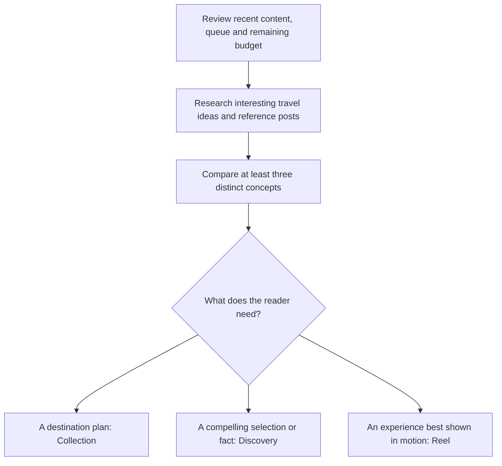
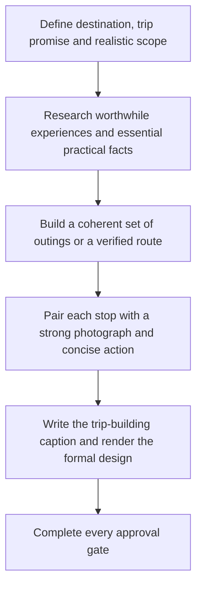
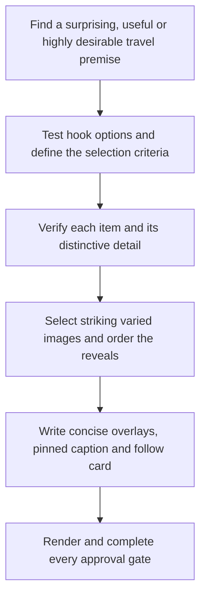
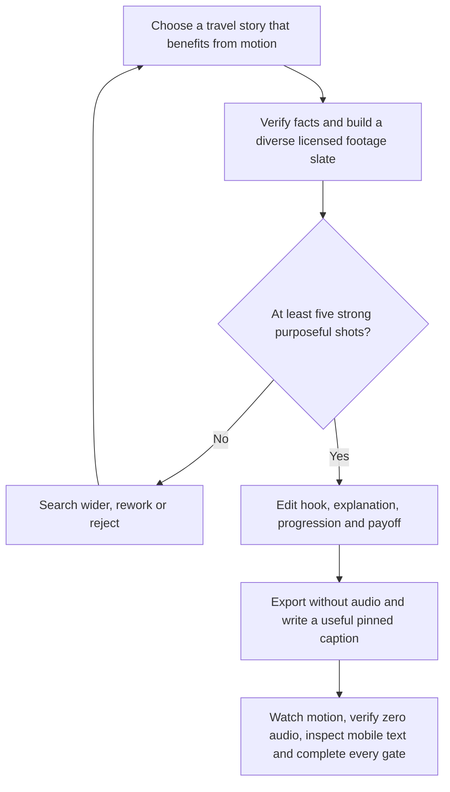
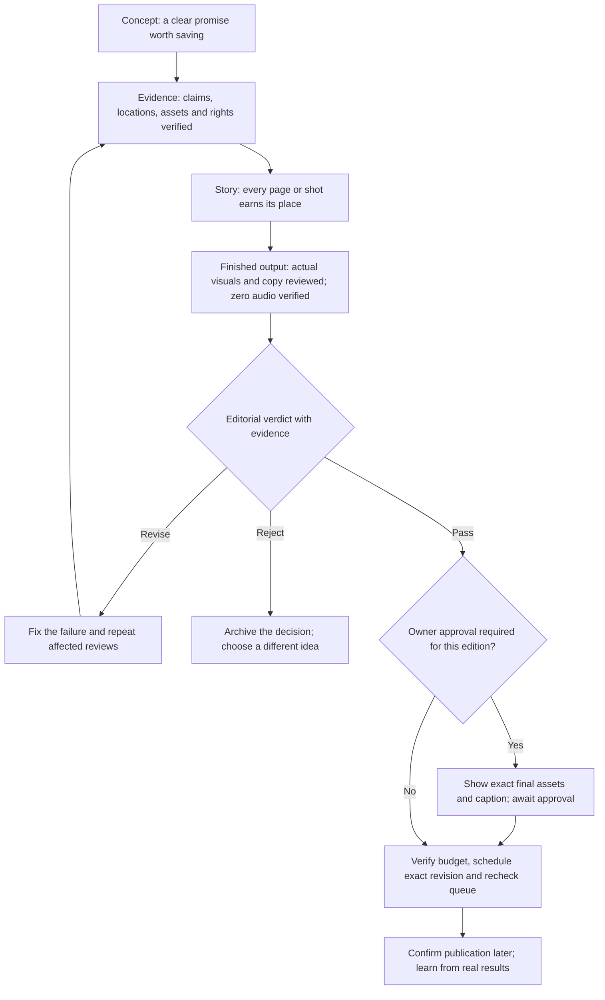

# Your Travel Atlas — three-format creation process

Version 8 · 30 October 2026 · Owner-directed framework

One travel publication, three distinct editorial jobs. Choose the idea and the reader's need first; then select the right format. This supersedes the former rule that every carousel must use the same discovery treatment. Read with [Editorial Guidelines](EDITORIAL_GUIDELINES.md), the [approval gates](EDITORIAL_REVIEW.md), [reference evidence](EDITORIAL_BENCHMARKS.md) and, for video, [Footage Sources](FOOTAGE_SOURCES.md).

## The three formats

| Format | Reader promise | Presentation | Information | Numbering |
| --- | --- | --- | --- | --- |
| **Travel Discovery Collection** | “Here is how to enjoy this particular destination.” | Formal photographic editorial design based on the published Faroe Islands issue: masthead, fine rules, destination hierarchy, serif headlines and considered captions. | Named essentials, what to do, why it is worthwhile, plausible connections and useful choices. Supporting image copy stays concise; caption carries the practical plan. | Internal ID only; no public issue number. Published Faroe remains the visual reference. |
| **Discovery carousels** | “Here are places, experiences or facts you will want to discover and save.” | Striking image, gripping plain-language title, small handle, concise descriptive support and a scenic follow card. | Specific facts suited to the premise: route distance, animal identity, a film scene, season, unusual feature or what makes a place special. | No public issue number on new editions. Internal IDs remain. |
| **Travel Reels** | “See what makes this experience worth having—and learn enough to save it.” | Real moving footage, a visual hook, readable selective overlays, small handle, clear place identification and silent exports. | A story with progression and useful discoveries on screen; caption supplies exact places and material planning details. | Separate internal Reel sequence; no public issue or clip counter. |

These are formats, not three inflexible topic buckets. A weekend in Porto could be a collection guide if it offers a useful destination plan, or a discovery carousel if it selects a few compelling experiences. Its reader promise and information structure decide. Do not publish both versions close together merely to fill slots.

## Shared start: discovery before production

Research across accessible travel publications, official destination sources, Instagram, TikTok, blogs and books. Vary sources over time; there is no requirement to inspect every medium for every post. Record what was actually read or watched. Social posts provide inspiration; primary sources verify the claims. Identify a real reason to visit, save or send the idea before choosing a layout.

For each candidate record: working hook, reader promise, scope, format, distinctive angle, strongest useful details, likely visual evidence, effort/accessibility, save/share reason and difference from recent content. Choose the strongest. If the footage or photographs cannot deliver it, search more widely, rework honestly or reject it.

## 1. Travel Discovery Collection

**Job:** help someone picture and begin planning an enjoyable trip to one place or coherent region. Use the published Faroe design as the visual anchor; improve the substance beyond generic landmark labels.

1. Define the intended trip: a weekend, a base with separate day trips, a rail journey, an island escape or another honest scope. State whether the stops form a route or are separate choices. Never imply a multi-island collection is a single-day walk.
2. Find the particular things worth travelling for. Research named experiences, cultural places, food, natural features, transport and meaningful seasonal events. Include a festival only if it improves this specific trip.
3. Establish enough practical coherence for the promise: sensible direction, plausible transfers, trip length if researched, relevant opening days and accessibility/effort. Include alternatives when they solve a real traveller need. Do not turn every guide into a minute-by-minute itinerary.
4. Give each supporting page one job: **exact place + what to do + distinctive payoff**. For example, a statement about following a particular path to a sea gorge is useful; “explore this beautiful village” is not. Keep supporting editorial overlays within 30 words, including headings/context. More depth comes from better selection, sequence, additional useful pages and the caption, not smaller text.
5. Use the Faroe family of design elements: photographic full frames, formal hierarchy, restrained cream/white typography and fine rules. Retain a clear destination and publication identity; no public issue numbers. Do not revive WANDER FURTHER or force dense cream planning panels into the format. Use one scenic follow card at the end of new editions.
6. Write a caption that turns the images into a usable starting plan: 📍 exact places mapped to pages, what to do, how outings connect where relevant, a useful timing/access detail and what must be checked before booking. Include the cover's location when it depicts a destination stop. Essential travel context must be available in the post/caption.

**Format-specific approval question:** could a reader explain what they would actually do there and how the choices fit a plausible trip? If the answer is only “see some pretty spots”, revise or reject.

## 2. Discovery carousels

**Job:** win attention with an honest, exciting promise and reward every swipe with a distinctive discovery. Model hospitality.guide's clarity and ease of reading, using original research, selection, wording and licensed images.

1. Explore broad and narrow ideas: road trips, wildlife, parks, rail, villages, filming locations, seasonal spectacles, unusual facts and occasional weekend discoveries. Titles such as “Road trips to take before you die” can work if the selection earns the promise. “Best” means an explained editorial selection, not an invented objective ranking.
2. Draft at least two strong title options. Choose the clearest accurate promise. Identify why someone would send this particular post to a friend. Avoid false exclusivity, exaggerated secrets and a hook that the content cannot repay.
3. Specify the inclusion criteria and the number of actual items. A promised ten means ten—not eight plus a cover and follow card. The current production pipeline supports 5–10 total pages; a larger worthwhile idea needs a verified, tested expansion or an honest smaller hook. Never silently shorten the promised list or crowd ten illegible items onto a few pages.
4. Each supporting image gets an exact subject/name and one concise, informative explanation, normally well below the absolute 30-word maximum including contextual labels. Match the detail to the subject: a road distance, a species/habitat, why a village looks unusual, what a rail segment reveals, or a real film scene. A set of unexplained place names fails; a miniature brochure on every page also fails.
5. Order pages for visual and informational variety. Prefer different landscapes, scales and experiences over near-identical attractive photographs. Use a single scenic follow card. The cover is mainly an exceptional image and the hook; discreet @yourtravelatlas, no public issue number.
6. The caption begins with a gripping accurate line, then supplies 📍 matched spots and the facts people need for this premise. Give useful specifics beyond repeating overlays. A list spanning a country is not automatically an itinerary; say so when necessary.

**Format-specific approval question:** does every swipe repay the title with a specific discovery that belongs in this selection? If removing a page changes nothing, cut or replace it.

## 3. Travel Reels

**Job:** create travel desire through motion while making the viewer more informed. The five-shot Iceland content and lower-middle centred text placement are approved visual references.

1. Select an experience, journey, discovery, wildlife behaviour, cultural story or worthwhile collection. The premise must be interesting before the edit. Research references for opening frames, story progression and useful overlays; do not mistake visible play counts for proof of why a post performed well.
2. Write a short beat sheet with an information purpose for every shot. A useful progression is **visual hook → name/context → experience unfolding → distinctive insight → practical takeaway/payoff → brief follow/save invitation**. Combine beats where natural; do not repeat this exact structure mechanically in every Reel.
3. Source at least five genuinely distinct, purposeful moving shots, normally 5–8. Multiple trims of one shot do not manufacture variety. Search Pexels plus another suitable source from the sourcebook; specialist archives may suit wildlife or transport. Prefer native vertical or suitable 4K footage. Verify exact subject, rights, actual dimensions and the intended portrait crop. Reject low-quality, mislocated, generic or near-duplicate filler. If the story cannot support five strong shots, choose a better premise rather than waive the requirement.
4. Make the video itself explain the premise. Show where it is, what is unusual, what the viewer could do and at least one useful specific discovery. Use short selective overlays; allow the footage space. Richness comes from meaningful images and facts, not text on every second. A scenery montage with a title and CTA alone fails this standard even if its caption is good.
5. Keep a small handle, clear early destination/subject identification near the top when appropriate, and readable contrasting serif editorial text in a safe lower band. Avoid competition between the hook and location labels. No public issue/clip counters or WANDER FURTHER. Check actual phone readability and allow time to read each overlay.
6. Let the story determine duration. As an editing starting point, roughly 20–35 seconds often gives five to eight shots room to convey substance; this is not a platform rule, quota or reason to pad. A shorter Reel must still satisfy the same footage, comprehension and usefulness gates. Do not hold every shot for the same length by default. Keep the follow prompt brief and on a worthwhile moving final image.
7. NO MUSIC on any content. Stop soundtrack sourcing and auditions. Export Reels without audio and verify zero audio streams. Inspect full motion, cuts, pacing and text. There is no listening gate for intentionally silent files.
8. Write a strong caption with 📍 exact featured places and enough specific information to act on the inspiration: experience, seasonal window, route, access or booking fact as relevant. Match multi-location captions to the video order. Do not imply footage from different visits or seasons shows one continuous trip. Evergreen does not mean omitting material conditions.

**Format-specific approval question:** after watching, can someone say where this is, what makes it special and why/how they would experience it? “Nice scenery” is insufficient. If no actual motion-and-listening review is possible, the Reel remains unapproved.

## One rigorous approval process

All three branches enter the same review pipeline. Format-specific usefulness is assessed against the job above, not a one-size-fits-all itinerary checklist.

The detailed evidence, stop conditions and review record are in [EDITORIAL_REVIEW.md](EDITORIAL_REVIEW.md). No technical success, attractive cover, aggregate score or completed checklist can compensate for a wrong fact, weak story, bad crop or missing licence. A separate critical review pass must challenge the creator's choices; do not call it independent human review or multi-reviewer approval unless that actually happened.

**Approval ownership:** preserve the established autonomous internal review for routine posts. Owner approval is required when Ben explicitly requests it, for the current Istanbul replacement, or when an owner-approved edition is materially changed under an active owner-review agreement. This document is not approval of any unfinished asset. Later owner feedback approved the five-shot Iceland content and final typography; the no-music direction removes its soundtrack. Use exact-edition evidence, not the superseded four-shot review.

## Repeatability without sameness

- Keep the three editorial jobs stable. Improve research, photographs, clarity and editing within them; do not redesign the whole publication after feedback on one format.
- Retain the approximate three weekly slots and one Reel per fortnight replacing a carousel slot. Within the five carousel slots in a two-week cycle, a useful starting balance is two Collection guides and three Discovery posts. This is a planning default, not a quota or a new frequency. Quality can leave a slot empty.
- Continue the separate, flexible effort mix: about 40% easy exploration, 35% journeys/approachable experiences and 25% demanding adventure over time. Do not confuse this with the mix of publishing formats.
- Compare recent geography, activities, angle, effort and visual composition before commissioning. Do not force a festival, a weekend, an adventure or a particular number of pages into every idea.
- Keep reusable series design, the 30-word supporting-slide ceiling, standard scenic carousel follow card, source evidence and approval records. Vary story structure, selection, images, depth and duration according to intention.
- Evaluate saves/shares relative to reach, follows and useful Reel watch-time/completion data when available. Record metric definitions and sample limits. Judge changes over comparable posts; never promise virality or infer success from one post.

## Production handoff and current status

Read [CURRENT_STATE.json](CURRENT_STATE.json) and [outstanding work](OUTSTANDING_WORK.md) every run; re-fetch Metricool before acting. New briefs explicitly declare collection/discovery/reel, internal ID, promise, sources and review status. There is no public numbering or separate public Collection sequence.

Implemented: Collection/Discovery photo routing; formal Collection identity; discreet Discovery handle; 30-word supporting overlays; scenic follow cards; no public issue numbers; minimum five distinct Reel shots; smaller centred lower-middle discovery overlays; silent exports with zero-audio validation. Photo pipeline supports 5–10 total pages. Test/inspect unsupported changes before use.

Porto's broader visual selection and Riviera's train image remain priority revisions. Their old queued versions are held as drafts. Never pass either from a caption-only change or an irrelevant stock image. Destination guides record a coverage matrix of main sights, signature experiences, worthwhile discoveries, photographed subjects and justified omissions. Transport-led ideas visibly show the transport.

Iceland replaces Istanbul in its existing slot after the owner's content/typography approval and no-music instruction. Japan preserves its successful content with public numbering removed. Published Faroe is frozen. The 28 obsolete pilot/output files were removed with recovery in Git history; preserve active media and rights evidence.

The Thursday automation handles outstanding work before new commissioning, verifies the queue, learns from available analytics, plans future slots and reports only material results/blockers. GitHub's render/photo-audit workflows are event/manual triggered helpers, not recurring editorial jobs.
